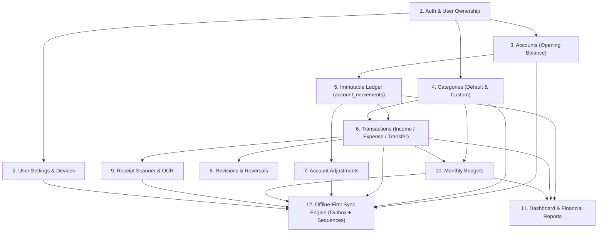

# Architecture Specification — Personal Finance Manager v1.0

**Baseline Reference:** `docs/PRD.md` (Master PRD Version 1.0)  
**Target Platform:** Android (Flutter) + Shared Hosting Backend (Laravel / MySQL)  
**Architectural Style:** Client-Server with Offline-First Strategy & Immutable Ledger

---

## 1. Requirement & Module Analysis

Berdasarkan Master PRD v1.0, sistem terdiri dari **13 modul fungsional** yang saling terintegrasi:

| No | Modul | Lingkup Utama | Komponen Terkait |
|---|---|---|---|
| 1 | **Authentication & Identity** | Registrasi, login, logout, refresh/me, isolasi data berbasis `user_id` | Sanctum, `users`, Flutter Secure Storage |
| 2 | **Device Management** | Registrasi perangkat multi-device, status aktif, revoke device | `devices`, `sync_cursors` |
| 3 | **User Settings** | Profil, ubah password, tema (Light/Dark/System), timezone, budget warning, currency (`IDR`) | `user_settings` |
| 4 | **Dashboard** | Total saldo aktif, ringkasan cash flow periode, chart, transaksi terbaru, ringkasan budget | Aggregates local SQLite (offline) |
| 5 | **Account Management** | Multi-rekening (`cash`, `bank`, `e_wallet`, `other`), opening balance, archiving, balance cache | `accounts`, `account_movements` |
| 6 | **Category Management** | Kategori kustom & default (`income`, `expense`), soft-disable (`is_active`), sorting | `categories` |
| 7 | **Transaction Management** | Income, Expense, Transfer antar-rekening, search, filter, sort, pagination | `transactions`, `account_movements` |
| 8 | **Ledger & Account Movements** | Sumber kebenaran saldo (`opening`, `transaction`, `reversal`, `adjustment`), immutable movements | `account_movements` |
| 9 | **Revision & Reversal Audit** | Edit & void transaksi via reversal mutasi aktif, penyimpanan `before_data` & `after_data` | `transaction_revisions`, `account_movements` |
| 10 | **Account Adjustments** | Koreksi saldo manual dengan alasan dan mutasi ledger bertanda (+/-) | `account_adjustments`, `account_movements` |
| 11 | **Receipt Scanner & OCR** | Kamera/galeri, crop/rotasi, ML Kit OCR on-device, ekstraksi teks, upload privat (<= 5 MB) | `receipts`, ML Kit, `storage/app/private` |
| 12 | **Budget Management** | Anggaran bulanan, batas total & per kategori `expense`, peringatan default 80% & 100% | `budgets`, `budget_categories` |
| 13 | **Financial Reports** | 9 jenis laporan keuangan, filter tanggal, visualisasi `fl_chart`, ekspor PDF & Excel | Local SQLite & Server Reports API |
| 14 | **Offline-First Sync Engine** | Local outbox, batch push idempoten, cursor pull berbasis sequence per-user, deteksi konflik | `sync_outbox`, `sync_operations`, `sync_cursors`, `sync_sequences`, `sync_changes` |

---

## 2. Feature Dependency Graph

### Matriks Dependensi Kritis
1. **Identity → Semua Modul:** Seluruh data harus terikat pada `user_id` terautentikasi; registrasi harus atomik membentuk user + settings + kategori default + rekening Cash awal.
2. **Ledger → Accounts & Transactions:** `accounts.balance_cache` hanyalah optimasi; `SUM(account_movements.amount_signed)` adalah sumber kebenaran absolut.
3. **Transactions → Budgets & Reports:** Transfer antar-rekening dan transaksi `voided` tidak boleh masuk perhitungan pemasukan, pengeluaran, maupun penggunaan budget.
4. **Local SQLite + Outbox → Sync Engine:** Seluruh operasi penulisan di Flutter harus berkomitmen atomik ke SQLite + `sync_outbox` terlebih dahulu agar fitur bekerja penuh saat offline.

---

## 3. System Architecture (Client-Server Offline-First)

### 3.1 Mobile Application (`mobile/`) — Feature-First Clean Architecture
- **Presentation Layer:** Flutter Material Design 3 widgets, `GoRouter` navigation shell (5 bottom navigation tabs + prominent add-transaction FAB), `fl_chart`, form validation.
- **Application Layer:** `Riverpod` providers/notifiers dan Use Cases yang mengoordinasikan domain & repository.
- **Domain Layer:** Immutable entities, business/ledger rules (konsisten dengan server), repository contracts.
- **Data Layer:** `Drift` + `SQLite` (sumber data langsung bagi UI), `Dio` HTTP client, `SyncManager` (Outbox push + Sequence pull).
- **Device Services:** `FlutterSecureStorage` (Sanctum token & session metadata), Camera/Image processing, Google ML Kit OCR, Connectivity & WorkManager.

### 3.2 Backend Application (`backend/`) — Layered Laravel API (`/api/v1`)
- **API Layer:** Versioned routes (`/api/v1/*`), `Controllers/Api/V1`, `FormRequest` validation, `JsonResource` formatting, Sanctum auth middleware, unified JSON exception handler.
- **Service Layer:** `LedgerService`, `AccountService`, `TransactionService`, `TransferService`, `BudgetService`, `ReceiptService`, `SyncService`.
- **Domain Layer:** Aturan invariansi ledger, deterministic UUID row locking (`SELECT ... FOR UPDATE`), optimistic concurrency (`version`), idempotency enforcement.
- **Data Layer:** Eloquent models (UUID `CHAR(36)` PKs), MySQL/MariaDB InnoDB database transactions.

### 3.3 Core Architectural Rules (PRD Section 3.4 & 18.3)
1. UI tidak pernah melakukan query SQLite secara langsung maupun memanggil HTTP API secara langsung.
2. SQLite adalah sumber data langsung bagi UI; server API tidak boleh memblokir tampilan data lokal.
3. Operasi finansial bersifat **atomic** pada client maupun server.
4. Mutasi (`account_movements`) yang sudah diposting tidak pernah di-edit atau di-delete; perubahan dilakukan via **reversal + replacement posting**.

---

## 4. Shared Hosting Compatibility & Constraints

Backend dirancang agar berjalan mulus di **shared hosting** (cPanel / Apache / LiteSpeed + PHP + MySQL/MariaDB) tanpa ketergantungan VPS:
1. **Tanpa Daemon Permanen:** Tidak bergantung pada Laravel Horizon, Supervisor, Redis worker, atau WebSocket server.
2. **Stateless Request Lifecycle:** Seluruh REST API dan batch sync (`/sync/push`, `/sync/pull`) diproses secara sinkron dalam request HTTP dengan ukuran batch terkontrol (maksimal 50–100 operasi per request untuk menghindari `max_execution_time`).
3. **Cron Job Standar:** Jika ada pemeliharaan berkala (mis. pembersihan token kadaluarsa), cukup menggunakan `* * * * * php artisan schedule:run`.
4. **Private File Storage:** Lampiran nota (`receipts`) disimpan di luar `public_html` (`storage/app/private/receipts/...`) dan hanya dapat diunduh melalui endpoint terautentikasi (`GET /api/v1/receipts/{id}/download`) setelah validasi ownership.
5. **Kompresi Client-Side:** Gambar nota dikompresi di perangkat Android (batas default <= 5 MB) sebelum upload `multipart/form-data` guna mematuhi batas `upload_max_filesize` dan `post_max_size` shared hosting.

---

## 5. Implementation Risks & Mitigations

| Risiko | Dampak | Mitigasi Teknis |
|---|---|---|
| Drift antara `balance_cache` dan ledger | Saldo rekening tidak akurat | Semua perubahan saldo lewat `LedgerService` dalam `DB::transaction`, `SELECT ... FOR UPDATE` berurutan secara leksikografis UUID, serta fitur rekonsiliasi saldo. |
| Duplikasi transaksi saat jaringan tidak stabil | Saldo terpotong/bertambah 2x | Client mengirim UUID `operation_id`; server menegakkan `UNIQUE(user_id, operation_id)` di `sync_operations` dan mengembalikan `response_data` sebelumnya. |
| Konflik edit multi-perangkat bersamaan | Data lebih baru tertimpa | Optimistic Concurrency Control berbasis kolom `version` (`base_version`); mismatch mengembalikan HTTP `409 Conflict`. |
| Timeout PHP pada shared hosting saat sync massal | Sebagian operasi gagal | Batching di client (50 ops/request) + atomicity per-operation di server. |
| Kebocoran data lintas pengguna | Pelanggaran privasi | Composite FK pada skema MySQL + scoping `auth()->id()` di semua query/service; server mengabaikan `user_id` kiriman client. |
| Ruang penyimpanan lokal & cache build di Windows dev | Build gagal | Seluruh cache (`PUB_CACHE`, `COMPOSER_HOME`, `GRADLE_USER_HOME`) dan SDK diarahkan ke Drive `D:\`. |

---

## 6. Technical Inconsistency Audit & Recommended Fixes (PRD v1.0)

Berdasarkan audit teknis mendalam terhadap Master PRD v1.0, ditemukan **6 ketidakkonsistenan/gap teknis** yang didokumentasikan di bawah ini untuk ditangani pada fase implementasi terkait (tidak diubah diam-diam):

### Issue 1 — Composite Foreign Keys Memerlukan Unique Index Parent (MySQL/MariaDB InnoDB)
- **Temuan PRD:** Section 6.3 menginstruksikan *"The database should use a composite foreign key from transactions to categories using category_id, user_id, and category_type"*, dan Section 6.4 Rule #2 mewajibkan foreign key mencegah cross-user references.
- **Masalah Teknis:** Di InnoDB, sebuah composite FK harus merujuk tepat ke `PRIMARY KEY` atau `UNIQUE INDEX` dengan urutan kolom yang identik pada tabel parent. Definisi tabel `categories`, `accounts`, `transactions`, `budgets`, dan `devices` di Section 6.3 belum mencantumkan index komposit `UNIQUE` tersebut.
- **Rekomendasi Fix (Phase 2):** Tambahkan composite `UNIQUE` index di tabel parent:
  - `categories`: `UNIQUE (id, user_id)` dan `UNIQUE (id, user_id, type)`
  - `accounts`: `UNIQUE (id, user_id)`
  - `transactions`: `UNIQUE (id, user_id)`
  - `budgets`: `UNIQUE (id, user_id)`
  - `devices`: `UNIQUE (id, user_id)`

### Issue 2 — Kolom Nullable dalam Composite Foreign Key untuk Transaksi Transfer
- **Temuan PRD:** Pada `transactions`, transaksi `transfer` memiliki `category_id = NULL` dan `category_type = NULL`, sementara `user_id` bernilai `NOT NULL`.
- **Masalah Teknis:** Di MySQL/MariaDB InnoDB (`MATCH SIMPLE`), apabila satu kolom dalam composite FK bernilai `NULL`, constraint FK dilewati untuk baris tersebut. Selain itu, tanpa `CHECK` constraint tambahan, transaksi `income`/`expense` secara skema murni bisa saja tersimpan dengan `category_id = NULL`.
- **Rekomendasi Fix (Phase 2):** Kombinasikan composite FK dengan `CHECK` constraint MySQL 8.0.16+ / MariaDB (`(type = 'transfer' AND category_id IS NULL AND category_type IS NULL) OR (type IN ('income', 'expense') AND category_id IS NOT NULL AND category_type = type)`) serta validasi ketat pada `FormRequest` dan `TransactionService`.

### Issue 3 — Referensi `account_id` / `source_account_id` / `destination_account_id` pada `transactions`
- **Temuan PRD:** Skema tabel `transactions` pada Section 6.3 tidak menyertakan kolom `account_id`, `source_account_id`, atau `destination_account_id` (karena keterikatan rekening ada di `account_movements`), namun payload API Section 9.6 & 9.7 memakainya sebagai field input/output transaksi.
- **Masalah Teknis:** Jika endpoint list/detail transaksi atau `/sync/pull` hanya mengembalikan kolom tabel `transactions`, client tidak tahu rekening mana yang terlibat tanpa memuat mutasi terkait.
- **Rekomendasi Fix (Phase 2–4):** `account_movements` tetap menjadi satu-satunya sumber kebenaran saldo, sementara DTO/API Resource dan payload `/sync/pull` untuk entity `transactions` **wajib menyertakan relasi active `movements`** (atau kolom referensi terkelola `account_id` / `counterparty_account_id` yang diperbarui atomik bersama mutasi) agar tampilan daftar transaksi dan sinkronisasi antar-perangkat self-contained.

### Issue 4 — Tabel `sync_outbox` Lokal Kurang Kolom `operation_id` dan `base_version`
- **Temuan PRD:** Section 8.3 mencantumkan field outbox (`id, user_id, entity_type, entity_id, operation_type, payload, status, retry_count, created_at, updated_at`), namun Section 8.4 (`Sync Push`) mewajibkan client mengirim `operation_id`, `device_id`, dan `base_version`.
- **Masalah Teknis:** Tanpa menyimpan `operation_id` dan `base_version` secara persisten di outbox, proses retry setelah offline/restart bisa menghasilkan UUID operasi baru (menggagalkan idempotency!) atau kehilangan versi dasar konflik.
- **Rekomendasi Fix (Phase 5):** Tambahkan `operation_id TEXT NOT NULL UNIQUE`, `device_id TEXT NOT NULL`, `base_version INTEGER NOT NULL DEFAULT 0`, dan `last_error TEXT NULL` ke skema tabel Drift `sync_outbox`.

### Issue 5 — Hidrasi Data pada `GET /api/v1/sync/pull`
- **Temuan PRD:** Tabel `sync_changes` (Section 6.3) hanya menyimpan metadata perubahan (`sequence, entity_type, entity_id, operation, entity_version`), tanpa payload data entitas.
- **Masalah Teknis:** Jika `/sync/pull` hanya mengembalikan metadata `sync_changes`, client harus melakukan N+1 HTTP request tambahan untuk mengunduh setiap record—berisiko gagal parsial saat offline atau terkena rate limit di shared hosting.
- **Rekomendasi Fix (Phase 4–5):** Endpoint `GET /api/v1/sync/pull` melakukan **batch hydration** di server untuk setiap item pada `changes` dengan menyisipkan objek `data` (snapshot terbaru entitas terkait, termasuk `movements` untuk `transactions` atau timestamp `deleted_at` untuk operasi tombstone delete).

### Issue 6 — Konsistensi Kolom `version` & `deleted_at` untuk Multi-Device Sync & Tombstone
- **Temuan PRD:** Section 8.7 (Optimistic Concurrency) dan 8.8 (Deletion Tombstones) berlaku untuk semua entitas yang disinkronkan antar-perangkat, namun Section 6.3 hanya menuliskan `version` pada `transactions` dan tidak menuliskan `deleted_at` pada `budgets`, `budget_categories`, maupun `receipts`.
- **Rekomendasi Fix (Phase 2):** Standarisasi kolom `version INT UNSIGNED NOT NULL DEFAULT 1` dan `deleted_at DATETIME(3) NULL` pada seluruh entitas mutable yang ikut dalam mekanisme sync (`user_settings`, `accounts`, `categories`, `transactions`, `budgets`, `budget_categories`, `receipts`) agar deteksi konflik dan tombstone sinkronisasi seragam.

