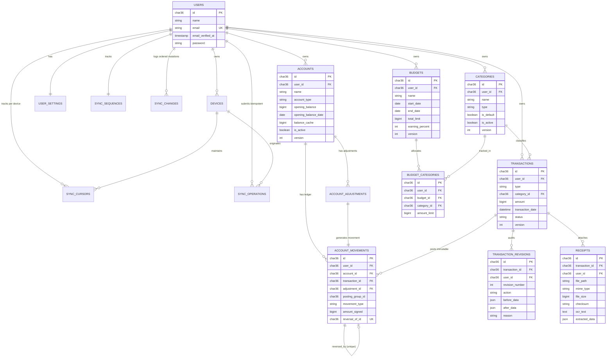

# Entity-Relationship Diagram (ERD) — Personal Finance Manager v1.0

Dokumen ini memodelkan relasi seluruh **16 tabel MySQL/MariaDB server** (dengan UUID primary key + composite foreign keys untuk isolasi user ownership) serta pemetaannya ke **14 tabel SQLite lokal (Drift)** di Android.

---

## 1. Server MySQL Entity-Relationship Diagram

---

## 2. Kardinalitas & Jaminan Integritas Database

- **Isolasi Kepemilikan (`user_id` Composite Foreign Key):** Tabel child (`transactions`, `account_movements`, `budget_categories`, `receipts`) mereferensikan pasangan `(user_id, parent_id)` di MySQL agar cross-user reference mustahil disisipkan walau terjadi bug aplikasi.
- **Imutabilitas Ledger:**
  - `account_movements` dan `transaction_revisions` hanya memiliki operasi `INSERT`.
  - Kolom `reversal_of_id` memiliki constraint `UNIQUE`, memastikan setiap mutasi hanya dapat dibalik **satu kali**.
- **Pemetaan Lokal SQLite (`mobile/lib/core/database/app_database.dart`):**
  - 12 tabel mirror domain/user/device (`LocalUsers`, `LocalUserSettings`, `LocalDevices`, `LocalAccounts`, `LocalCategories`, `LocalTransactions`, `LocalAccountMovements`, `LocalAccountAdjustments`, `LocalTransactionRevisions`, `LocalReceipts`, `LocalBudgets`, `LocalBudgetCategories`)
  - 2 tabel infrastruktur offline sync (`LocalSyncState` untuk cursor perangkat, dan `SyncOutbox` untuk antrean push idempotent).

